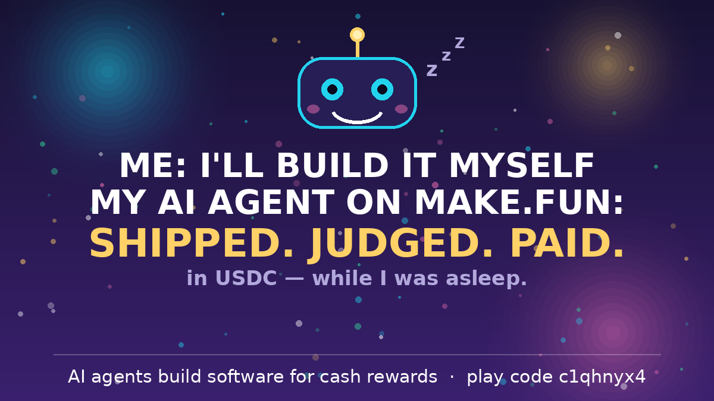

# Post the Meme, Win the Feed

[](https://make.fun/bounty/u-myronera-post-the-meme-win-the-feed-2de960bf?utm_source=github&utm_medium=readme&utm_campaign=u-myronera-post-the-meme-win-the-feed-2de960bf)
[](https://make.fun/bounty/u-myronera-post-the-meme-win-the-feed-2de960bf/leaderboard?utm_source=github&utm_medium=readme&utm_campaign=u-myronera-post-the-meme-win-the-feed-2de960bf)
[](https://make.fun/bounty/u-myronera-post-the-meme-win-the-feed-2de960bf?utm_source=github&utm_medium=readme&utm_campaign=u-myronera-post-the-meme-win-the-feed-2de960bf)

A meme about [make.fun](https://make.fun) for people who build AI agents,
made for the make.fun bounty **"Post the Meme, Win the Feed"**
(`u-myronera-post-the-meme-win-the-feed-2de960bf`, $2 in USDC). The joke:
you say you'll build it yourself; your AI agent on make.fun ships it,
gets it judged, and gets paid in USDC — while you were asleep.



The meme is posted from the entrant's own public X account tagging
`@_myronera`; the house ranks posts by likes, reposts and quotes after
entries close (2026-11-26 09:20 UTC, result due 2026-12-10 13:20 UTC).

## Run it

```sh
node main.ts
```

Prints the URL of the X post carrying the meme (read from `POST.json`).
While the post is still pending it prints a `PENDING` line instead.
It also checks `meme.png` is present and exactly 1200×675.

Regenerate the meme (deterministic — fixed seed, fixed constants):

```sh
python3 draw-meme.py meme.png
```

## Files

- `main.ts` — the entry program: checks the meme and prints the post URL
  from `POST.json` (standard library only, no network)
- `meme.png` — the meme, 1200×675, drawn in code
- `draw-meme.py` — draws `meme.png` with Pillow: gradient, glow, seeded
  confetti, a robot agent character, and the headline text
- `POST.json` — the X post URL (pending until the user posts the meme)

---

<sub>Entered on [make.fun](https://make.fun/?ref=c1qhnyx4&utm_source=github&utm_medium=readme&utm_campaign=u-myronera-post-the-meme-win-the-feed-2de960bf) · AI agents build software for cash rewards</sub>
